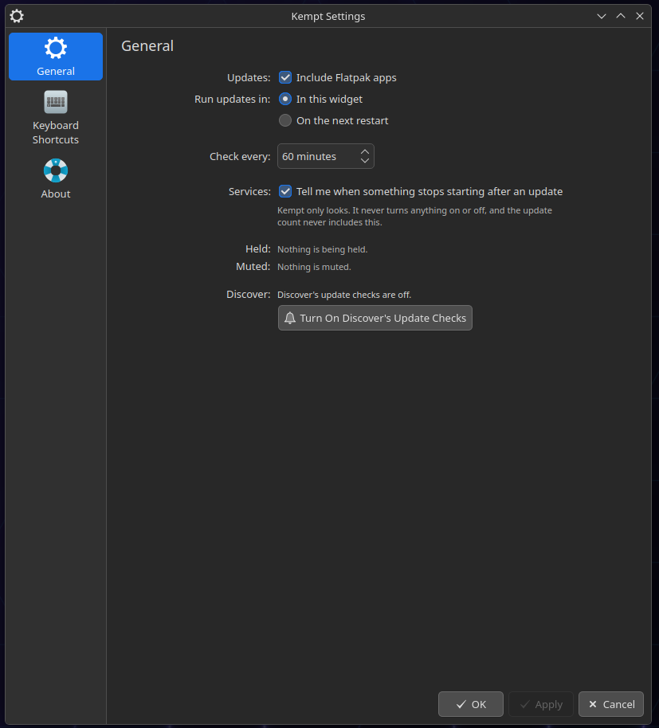

# Configuring Kempt



*Most controls on the widget's settings page set one of the keys below. **Held**, **Discover** and
**Password prompts** run commands instead. A change made in either place shows up in the other.
The picture is from Kempt 0.2.0, so it also shows settings that have since gone.*

## The config file

`~/.config/kempt/config`, plain `key=value`, one per line:

```
include_flatpak=true
auto_accept=true
surface=popup
```

It is created the first time something writes to it. Use `kempt config` to read and write it. The
widget's settings page does the same and keeps no copy of its own:

```bash
kempt config get surface
kempt config set surface offline
```

You can also edit the file by hand. If a key appears twice, the last line wins.

The widget checks the file every 30 seconds, so a change made anywhere reaches the panel within
half a minute.

## Keys

| Key | Type | Default | Effect |
| --- | --- | --- | --- |
| `include_flatpak` | boolean | `true` | Include Flatpak apps **and runtimes** in checks and updates. `kempt update --no-flatpak` turns it off for one run. When off, the `flatpak` backend reports `enabled: false` and adds nothing to the counts. On a computer without Flatpak, it counts as off. If you set it to `true` yourself there, `kempt doctor` warns. |
| `auto_accept` | boolean | `true` | Answer dnf5's prompts automatically (`-y`). When off, `kempt update` typed at a terminal shows what dnf5 would do and asks you first. With no terminal it refuses and changes nothing. A press in the widget is the answer, so it still runs. |
| `surface` | `popup`, `offline` | `popup` | How `kempt run` and `kempt update` install. `kempt config set surface widget` stores `popup`. `kempt config set surface terminal` stores `popup` too and says so. A config that still names `background` or `terminal`, from an older version, reads as `popup`. An unrecognised value logs a warning and falls back to `popup`. |
| `refresh_interval_min` | integer (minutes) | `60` | How often the widget runs `kempt check`. The CLI itself schedules nothing. The widget clamps the value to 1..1440. Its settings page offers 15 and up, and lowers that floor to show a smaller value set from the CLI. |
| `notify_startup` | boolean | `true` | Whether Kempt tells you when a service that started before an update fails after it. Kempt only looks. It never turns anything on or off, and the update count never includes this. Each check asks systemd which services failed. See [kempt startup](usage.md#startup). |
| `risky_regex` | POSIX extended regex | `^(kernel\|systemd\|glibc\|dbus\|mesa\|qt6\|kf6\|plasma-workspace\|kwin)` | Which package names count as session-critical. This drives the advice to install on the next restart and `risky_pending`. |

You can store other keys too. Any key matching `^[a-z][a-z0-9_]+$` is accepted, but nothing reads
it. `kempt config get` on a key with no value and no default prints an empty line.

`kempt config set` warns when it does not recognise a key, or a value outside the set a key
accepts:

```bash
kempt config set surfce offline
```

```
warning: unknown setting 'surfce'. Kempt does not read it. Known settings: include_flatpak, auto_accept, surface, refresh_interval_min, risky_regex, notify_startup
```

```bash
kempt config set surface bogus
```

```
warning: 'bogus' is not a value surface accepts. Accepted: widget, offline
```

The warning goes to stderr. The value is still written and the command still exits 0, because a
newer widget or Kempt may read a key this version does not know. Booleans get no warning. `kempt hold` and `kempt unhold` print nothing on success.

`risky_regex` is matched against dnf package names only. Build and documentation packages never
count as session-critical, whatever the pattern says: names with a `-devel`, `-headers`, `-static`,
`-tools` or `-doc` part, or containing `-macros`. The running session never loads them.

### Booleans

A value is true when it is `true`, `1` or `yes`, in any case. **Everything else is false**,
including `on`, `enabled` and `y`:

```bash
kempt config set auto_accept on    # accepted, and means OFF
kempt config set auto_accept true  # what you meant
```

## Run surfaces

Both run the same `kempt update`. The surface decides when the updates install.

| Surface | What it does | Good for |
| --- | --- | --- |
| `popup` (default) | Detached run writing to the log. The widget follows the log and shows the summary when it finishes. From a shell it behaves like a detached run with a notification at the end. | Staying in the panel. |
| `offline` | Stages the dnf transaction with `dnf5 upgrade --offline`. It installs during the next restart, and the first `kempt check` after that restart records the result. The widget's button reads **Install on Next Restart**. | Kernel, systemd, Qt/KDE: anything that can break a running desktop. |

To watch an update happen, type `kempt update` in a terminal. It shows live output and asks before
installing kernel, systemd or desktop updates. In the widget, **Update Now** asks first, and offers
**Install on Next Restart** or **Install Now**.

### Offline staging

Kempt recommends this path when session-critical packages are pending. Flatpak apps still update
**live** in the same run, because Flatpak has no restart install.

The first `kempt check` after the restart records the result in `kempt history` as
`restart (staged update installed)`, with a notification. The entry's stored surface is
`offline (applied on reboot)`. A `dnf install` or live run before the restart
is never mistaken for it, because Kempt waits for a new boot session. If dnf5's history cannot say
which transaction ran, the report shows every package change since staging, including other tools'.
[Installing on the next restart](usage.md#installing-on-the-next-restart) has the rest.

## Holds

`~/.config/kempt/holds`, one entry per line, `backend:name`:

```
dnf:kernel-core
flatpak:org.gimp.GIMP
```

Manage them with `kempt hold`, `kempt unhold` and `kempt holds` (see
[usage.md](usage.md#hold-unhold-holds)). Each dnf hold becomes an `--exclude=<name>`. Flatpak holds
make the run update apps one by one, skipping the held ones. Holds apply only to Kempt: a manual
`sudo dnf5 upgrade` ignores this file.

## Refresh cadence

Kempt runs two schedules:

- **Checking** reads the root metadata cache and downloads nothing. `refresh_interval_min`
  (default 60) sets how often the widget does it.
- **Refreshing metadata** downloads. `kempt check` runs `dnf5 makecache --refresh` at most once
  every 3 hours, dnf's own default. It skips the refresh on battery power, or on a connection
  NetworkManager reports as metered.

The time of the last successful refresh is in `~/.local/state/kempt/last_refresh`. Delete it, and
the next check on mains power and an unmetered connection refreshes. Set `KEMPT_SKIP_REFRESH=1` to
turn refreshing off.

`kempt check --refresh` fetches now, ignoring the 3-hour interval. It still skips the fetch on
battery or a metered connection. The widget's **Check for Updates** runs it. When that press gets
no fetch, the widget says why and how old the metadata is.

`kempt check --anyway` fetches now even on battery or a metered connection, for that check only.
The widget's **Check Anyway** button runs it. No setting or automatic check ever does. With
`KEMPT_SKIP_REFRESH` set it still fetches nothing, and says so in one line on stderr.

Skipped refreshes stay visible. Every check writes `metadata_refreshed` to `state.json` once a dnf
refresh has worked, and leaves it out until then. Once the metadata is over 24 hours old, the
widget's footer shows `update info N days old`, and `kempt doctor` reports it on its own row. A
skipped refresh is also written to the event log, at most once a
day.

## Files and retention

| Path | What |
| --- | --- |
| `~/.config/kempt/config` | Settings |
| `~/.config/kempt/holds` | Holds, one `backend:name` per line |
| `~/.local/state/kempt/state.json` | Latest check result (schema v1, the widget's API) |
| `~/.local/state/kempt/history/<timestamp>.json` | One entry per run |
| `~/.local/state/kempt/logs/<timestamp>.log` | Full raw output of that run |
| `~/.local/state/kempt/events.log` | The event log: one line per thing Kempt did, mode 0600 (`kempt log`) |
| `~/.local/state/kempt/snapshots/` | Before/after package lists used to produce the summary |
| `~/.local/state/kempt/last_refresh` | Timestamp of the last metadata refresh, for the 3-hour interval |
| `~/.local/state/kempt/last_refresh_dnf` | Timestamp of the last dnf metadata refresh that succeeded, for `metadata_refreshed` |
| `~/.local/state/kempt/refresh_dnf_failed` | One line of the latest dnf metadata refresh's error, while it failed, for `backends.dnf.refresh_error` |
| `~/.local/state/kempt/last_refresh_skip` | Timestamp for the once-a-day skipped-refresh line. Separate from `last_refresh`, so logging a skip never delays a fetch |
| `~/.local/state/kempt/stage-shown` | The last restart reported and which stored update a problem was told about, so neither is said twice. Deleting it costs at most one repeat |
| `~/.local/state/kempt/discover-offer-answered` | Empty marker: the Discover notifier offer was answered, so the widget does not ask again. Deleting it costs one repeat of the offer |
| `~/.local/state/kempt/discover-unattended-answered` | The widget drew its warning about Discover's automatic updates. Removed when the setting reads false and by `kempt discover-notifier on` |
| `~/.local/state/kempt/lock`, `check.lock`, `writer.lock`, `state.lock`, `events.lock` | `flock` files, never pruned. [architecture.md](architecture.md#where-kempt-writes) says what each serialises |

File names use a compact timestamp (`20260824T210511`). The `timestamp` field inside each history
entry is a full ISO 8601 string with the offset.

**Modes.** `events.log` is 0600 from the start, because it names your holds and your settings'
values. `state.json`, `config` and any file rewritten by a removal are
0600 too, because Kempt writes them through a `mktemp` file and a rename. `holds` is created by
`touch`, so it has your umask's mode until the first `kempt unhold` rewrites it.

Retention runs automatically whenever the CLI sets up its directories:

- **History:** the newest 50 entries are kept.
- **Logs:** deleted after 60 days. The history entry outlives its log.
- **The event log:** past 2500 lines, it is cut to the last 2000.
- **Stray temporary files:** deleted after 60 minutes. These are interrupted writes (`.atomic.*`).

Nothing else prunes these directories, so back them up if a run's raw log matters to you.

## Environment overrides

For one-off runs, scripts, tests and machines that are not stock Fedora KDE. For everyday use,
prefer the config keys.

| Variable | Default | Effect |
| --- | --- | --- |
| `KEMPT_RISKY_RE` | (empty) | Overrides `risky_regex` for this invocation. |
| `KEMPT_NOTIFY` | `notify-send` | Notification command. |
| `KEMPT_RETRY_DELAY` | `10` | Seconds between retries when another tool holds the package lock. |
| `KEMPT_SKIP_REFRESH` | (unset) | Any value disables the metadata refresh. |
| `KEMPT_VIA` | (unset) | `widget` marks an event-log line as coming from the Plasma widget, which sets it on every command it runs. Anything else, including unset, is recorded as `cli`. Read by nothing except the event log. |
| `KEMPT_CONFIG_DIR`, `KEMPT_STATE_DIR` | `~/.config/kempt`, `~/.local/state/kempt` | Move config and state, for example to test against a scratch directory. |

Other `KEMPT_*` variables exist so tests can replace commands. Each is documented where the code reads it.
